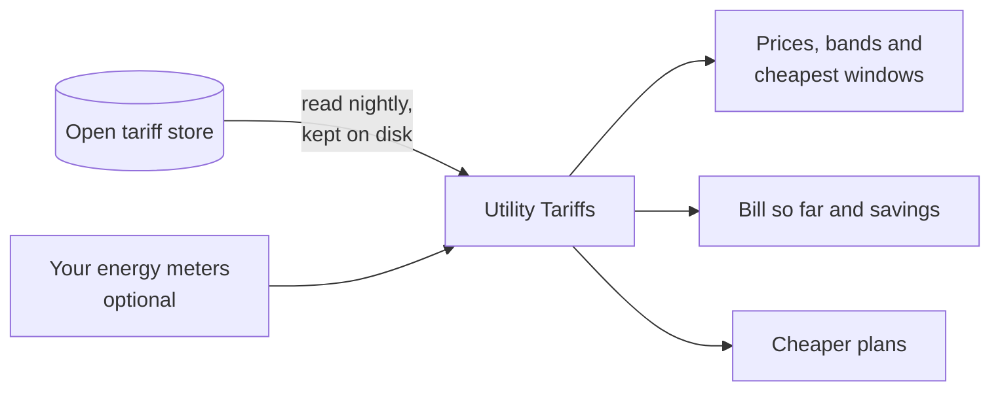
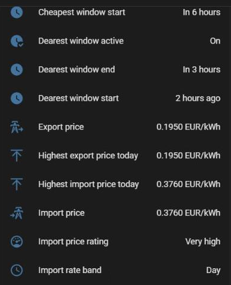

# Utility Tariffs

> **Note on the data.** The tariff data comes from an open tariff store. It is gathered by the methods
> that store uses, and each source has its own way of being read. Some sources will need updating over
> time and may change significantly. We will try to keep on top of as many as we can. The list is
> not exhaustive, because not every tariff is easy to gather. We will try to add more over time.
>
> **No manually entered tariffs in the store.** A tariff typed in by hand goes out of date without
> notice, so the store holds only tariffs that a source reads from a published page, file or feed.
> That is why this integration lets you type in your own rates for your own use. To ask for a
> supplier or to give feedback, [suggest a source](https://github.com/macuistin/utility-tariffs/issues/new?template=suggestion.md).

A Home Assistant integration that knows your tariff. It prices every half hour from the open
tariff store, and works out the cheapest and dearest windows, the bill so far and, with your own
energy sensors, what solar and a battery save and which plan would have cost least.

## What you get

| | |
| --- | --- |
| **Prices** | Import and export price now, rate band, next change, rating from very low to very high |
| **Windows** | Cheapest and dearest stretch of a length you choose, and a `find_window` action for a load of a given power |
| **Forecast** | Prices known for the next 48 hours, upcoming revisions, low and high price alerts |
| **Bill** | The bill so far from your own meters, lined up with your supplier's bill dates, and an HTML bill summary |
| **Savings** | What solar and a battery saved this bill period |
| **Cheaper plans** | Your last bill re-priced under every other plan in your country and area |
| **Works offline** | Tariffs and prices are held on disk, so sensors keep moving when the store cannot be reached |

  

## Quick install

1. In HACS, search for **Utility Tariffs** and download it. Restart Home Assistant.
   If it is not in the search yet, add `macuistin/ha-utility-tariffs` as a custom repository of
   type Integration, then download it.
2. Open Settings, Devices & services, Add integration, and choose **Utility Tariffs**.
3. Pick your country, supplier, plan and area, or type in your own rates.

Home Assistant needs internet access to read the tariff store. Only one tariff is followed.

## Examples

- Start a load in the cheapest window: trigger on **Cheapest window active**.
- Warn when the price is high: trigger on **Import price rating** becoming `high` or `very_high`.
- Send the bill by email or notification with the `utility_tariffs.bill_summary` action.
- Use the import and export price sensors in the Energy dashboard.

## Documentation

| Page | Covers |
| --- | --- |
| [Installation](docs/installation.md) | Install, set up a plan, remove |
| [Setup guide](docs/setup-guide.md) | Step by step setup and reconfigure, with pictures |
| [Configuration](docs/configuration.md) | Options, bill dates, your own rates, changing plan |
| [Features](docs/features.md) | Bill so far, savings, cheaper plans, Energy dashboard, bill summary |
| [Entities and actions](docs/entities.md) | Every sensor, the price forecast and the actions |
| [The tariff store](docs/tariff-store.md) | Where prices come from, how tariffs are kept current, the file format |
| [Troubleshooting](docs/troubleshooting.md) | Common problems, known limitations, reporting a bug |

## How it is built

All tariff, price, window, ranking, savings and billing code lives in
[utility-tariffs](https://github.com/macuistin/utility-tariffs) and is installed as one pinned
package. This repository is the Home Assistant glue around it. Electricity only to start.

## Licence

MIT. See `LICENSE`.
