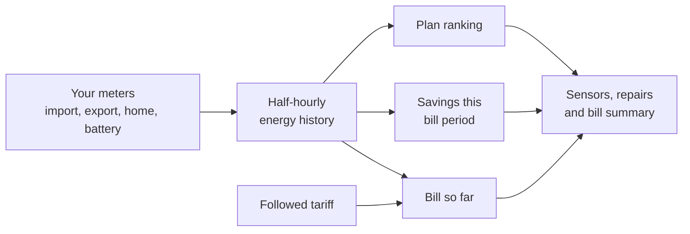

# Features



Every feature below that uses energy needs an import meter set in the
[options](configuration.md). Without one you still get prices, bands and windows.

## Use cases

- Start a load in the cheapest window: trigger on **Cheapest window active**, or call
  `utility_tariffs.find_window` for a load of a given power and length.
- Warn when the price is high: trigger on **Import price rating** becoming `high` or `very_high`.
- Send the bill by email or notification with `utility_tariffs.bill_summary`.
- Find out whether another plan would have cost less with **Cheapest plan saving**.

## Bill so far

In the integration's options, choose the sensors that count the energy you import and export, such
as your smart meter's totals (kWh, Wh or MWh, only ever rising). Every minute the rise since the
last reading is booked into a half-hourly history, which is saved and priced under the tariff for
the current bill period. You get the bill so far, the energy imported this period and how much of
the period the history covers. A meter that updates only every half hour or day books each step in
the minute it appears, so the bill by rate band can differ slightly from your supplier's.

## Cheap electricity used

With an import meter set, three sensors give the share of the electricity you imported that was
used at cheap times: today, this bill period (both on) and the last 30 days (off until enabled).
Each is a percentage, with `cheap_kwh` and `imported_kwh` as attributes. Today's figure works as a
rating for the day.

- By default a half hour is cheap when it falls in the tariff's cheapest import band. The band
  comes from the tariff and the price of a band from the engine. In the options, **Which half
  hours count as cheap** can instead count every band priced at or below today's average price,
  which suits a tariff with three or more bands.
- A tariff with a single price all day has nothing cheap to use, so the share is 0 and cannot
  improve. The sensor is not unavailable.
- A tariff that follows a price feed has no bands, and the prices of past days are not held, so
  the sensors are unavailable for it.
- They read the half-hourly history, so a new plan shows them from the filled history.

A fourth sensor, **Cheap electricity rating today**, labels today's share: `very_good` from 75%,
`good` from 50%, `average` from 25%, otherwise `poor`. Use it in automations and cards. A flat
tariff always rates `poor`. It is unknown until something has been imported today, so an empty day
is not rated `poor`.

## Savings

Add a sensor for the energy the whole home uses and you also get "Savings this bill period": what
the home would have paid buying all of its energy from the grid, less what it paid, with export
credit counted. The standing charge cancels, because both bills carry it. For a battery, add its
size and its charge sensor, and the value of the energy it holds more or less than when the bill
period began is added or taken off. A sensor for the energy taken out of the battery, and a wear
cost per kWh, take wear off. Without a record of what was bought for the battery, stored energy is
valued at the cheapest rate band.

A second sensor, "Savings share this bill period", gives the saving as a percentage of what the
bill would have been without it. It has `days_covered`, `days_in_period` and `coverage` attributes,
so a new plan with a short history does not look like a full period. It is unknown when the bill
without the saving is zero.

## Cheaper plans

When an import meter is set, the integration prices your last whole bill under every other plan of
your country and area in the store, every night shortly after midnight, and ranks them. **Plan
rank** is where your plan stands (1 is the cheapest), with the cheapest few plans and their bills
in its attributes. **Cheapest plan saving** is what the cheapest plan would have saved, and is 0
when yours is cheapest. When the saving is at least 5% of your bill, a repair notice names the
plan.

This re-prices what you used. It is not a forecast, it never switches your plan, and it does not
know exit fees, contract terms or whether a plan is open to you. A plan that lists no export price
is priced with your plan's export rate. Plans that hold only other areas, or cannot be read, are
left out and counted. To follow a plan, use Reconfigure.

## Energy dashboard

The import price and export price sensors can be used as the "entity with the current price" for
a grid connection in the Energy dashboard, and as the entity for export compensation.

- Both report the price per kWh in the tariff's currency, such as `EUR/kWh`, and move at every
  half hour.
- The export price is `0` when the tariff pays nothing for export, so it is always a number.
- The dashboard lists only price entities in your Home Assistant currency (Settings, System,
  General). A tariff in another currency does not appear in the picker.

## History from your meters

When a plan starts, and each time Home Assistant starts, the history is filled from your meters'
hourly long-term statistics, so a new plan does not begin with an empty bill. Each hour is spread
evenly over its two half hours. The result is exact only for a price that does not change within
the hour. A half hour that was counted live is never changed. An hour the statistics have no
figure for, or a rise no supply could deliver, is left empty and not counted as zero.

The `utility_tariffs.backfill` action runs the fill again. Use it after you add or change a meter.
Give `start` to fill from a later day than the one in the options. It replaces what an earlier fill
wrote and answers with `half_hours_filled`, `first_day` and `last_day`.

## Bill summary

The `utility_tariffs.bill_summary` action returns the bill so far as a self-contained HTML page in
`html`, with `total`, `currency`, `period_start` and the days priced beside it. The page lists the
energy imported in each band and every line of the bill (energy, saving, standing charge, levy,
VAT and export credit), so the lines add up to the total. It follows your light or dark setting and
fits a phone. It needs an import meter. Use the response in an email or a notification, or save it
to a file:

```yaml
action: utility_tariffs.bill_summary
data:
  config_entry_id: <your entry>
response_variable: bill
```
