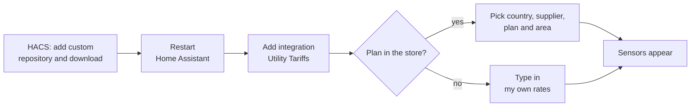

# Installation

## Install

1. In HACS, add `macuistin/ha-utility-tariffs` as a custom repository of type Integration, then
   download **Utility Tariffs**. Restart Home Assistant.
2. Open Settings, Devices & services, Add integration, and choose **Utility Tariffs**.
3. Choose **Pick a plan from the store**: country, supplier, plan and, where the plan has
   different prices by area, your area. Or choose **Type in my own rates**.

Home Assistant needs internet access to read the tariff store. One electricity tariff and one gas tariff can be followed.

Setup has no settings beyond the plan. The [options](configuration.md) switch on the bill, savings
and plan ranking.

## Remove

Open Settings, Devices & services, Utility Tariffs, the three dots, then **Delete**. The saved
energy history is deleted with it. The store cache under `.storage/utility_tariffs_store` and
`.storage/utility_tariffs_prices` can then be deleted by hand if you want the space back. To remove
the code, remove the repository in HACS and restart.
