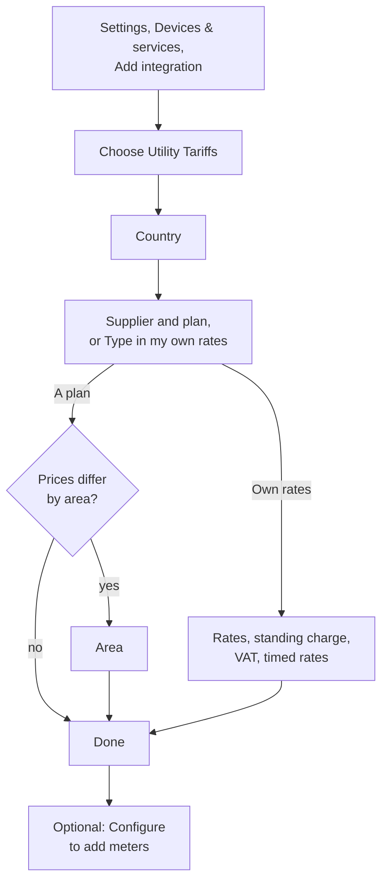
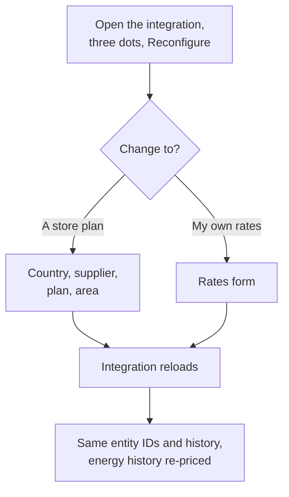
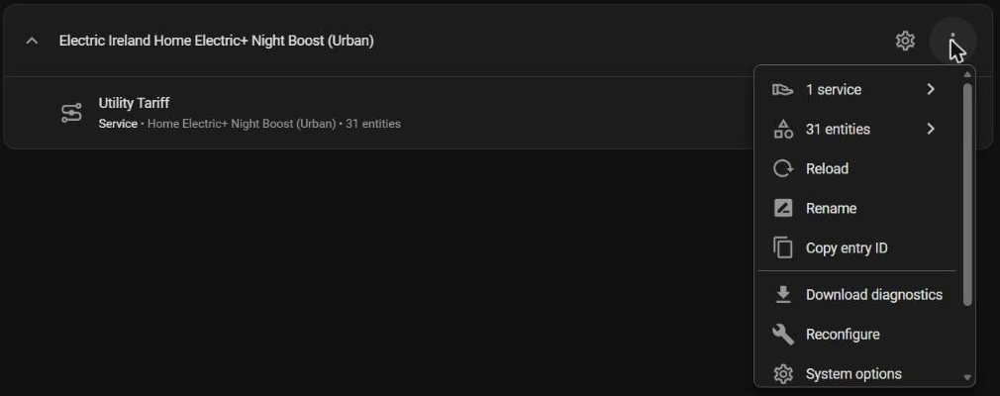
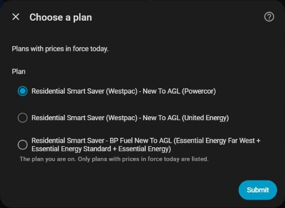
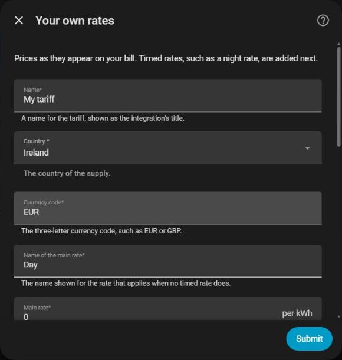

# Setup and reconfigure guide

Step by step, with a diagram for each path. The pictures are screenshots of Home Assistant's dark
theme. The integration follows one tariff only, so the country, supplier and plan pictures come from
the Reconfigure flow, which asks the same questions as first setup.

## First setup

1. Open Settings, Devices & services, then Add integration, and choose **Utility Tariffs**.

   

2. On the first page, pick your country. It starts at your Home Assistant country when the store
   holds it.

   

3. The second page is one list. **Type in my own rates** is at the top, for a plan that is not in
   the store. Below it is every supplier and plan for the country. Where the store holds only part
   of a country's prices, the page says what is missing. A third page names the plan and asks for
   your area, only where its prices differ by area. Each page shows which step it is. For your own
   rates, a shape page comes first, with flat, day and night, peak and off-peak, cheap midday and
   cheap overnight, so the form starts with the rate names and hours filled in.

4. Open the integration, choose the three dots, then **Configure**, to set the meters, window
   length and bill dates. Each is explained in [Configuration](configuration.md).

   

## Reconfigure

Reconfigure changes the plan or your own rates. The sensors keep their entity IDs, history and
place in the Energy dashboard, and the saved energy history is priced again under the new plan.

1. Open the integration, choose the three dots, then **Reconfigure**.

   

2. Pick another country, supplier, plan or area.

   

3. To change your own rates, enter the new rates in the form. Changing the rates means
   reconfiguring again.

   

## Configure or reconfigure?

| You want to change | Use |
| --- | --- |
| Plan, supplier, area or your own rates | Configure, Tariff (or Reconfigure) |
| Meters, battery, bill dates, window length, the other fuel | Configure, on the page for that topic |
