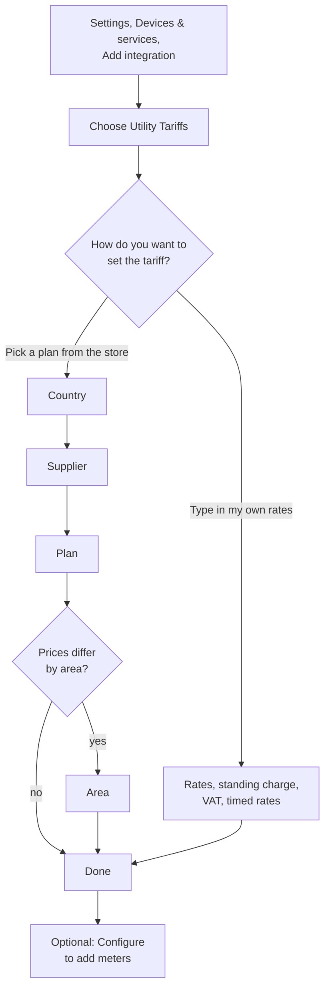
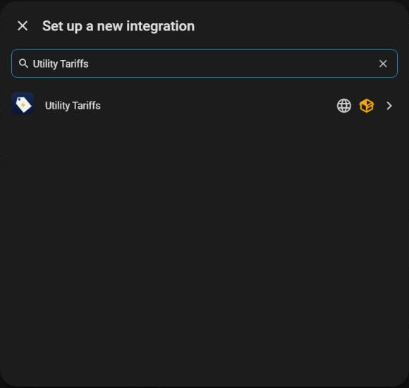
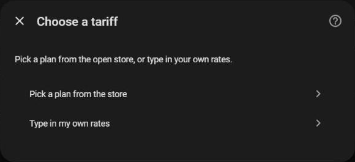
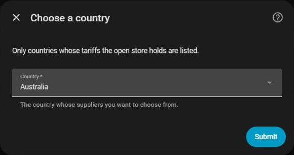
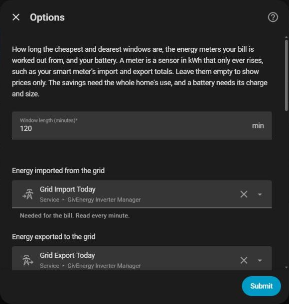
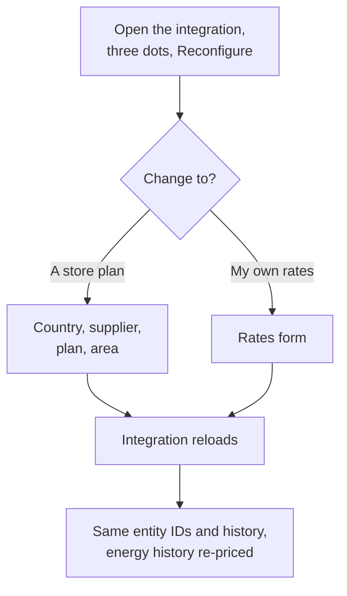

# Setup and reconfigure guide

Step by step, with a diagram for each path. The pictures are screenshots of Home Assistant's dark
theme. The integration follows one tariff only, so the country, supplier and plan pictures come from
the Reconfigure flow, which asks the same questions as first setup.

## First setup

1. Open Settings, Devices & services, then Add integration, and choose **Utility Tariffs**.

   

2. Choose **Pick a plan from the store**, or **Type in my own rates**.

   

3. For a store plan, pick the country on the first page. The second page lists every supplier and
   plan for that country in one list. Where the store holds only part of a country's prices, the
   page says what is missing. A third page asks for your area, only where the plan's prices differ
   by area. Each page shows which step it is.

   

4. Open the integration, choose the three dots, then **Configure**, to set the meters, window
   length and bill dates. Each is explained in [Configuration](configuration.md).

   

## Reconfigure

Reconfigure changes the plan or your own rates. The sensors keep their entity IDs, history and
place in the Energy dashboard, and the saved energy history is priced again under the new plan.

1. Open the integration, choose the three dots, then **Reconfigure**.

   

2. Pick another country, supplier, plan or area.

   

3. To change your own rates, enter the new rates in the form. Changing the rates means
   reconfiguring again.

   

## Configure or reconfigure?

| You want to change | Use |
| --- | --- |
| Plan, supplier, area or your own rates | Reconfigure |
| Meters, window length, bill dates, battery details | Configure (options) |
