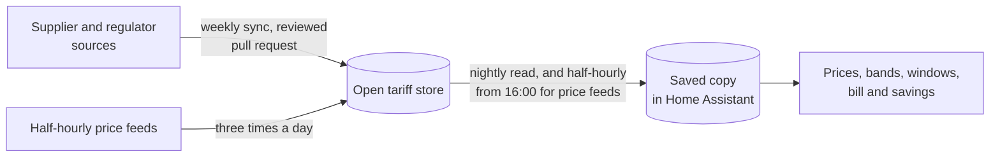

# The tariff store

The integration reads its prices from an open tariff store. All tariff, price,
window, ranking, savings and billing code is written and tested in the `utility-tariffs-lib`
package on [PyPI](https://pypi.org/project/utility-tariffs-lib/), listed in `manifest.json` and
installed as one pinned release. This integration is the Home Assistant
glue around it: the cache, timers, repairs, storage and entities.

## Data updates

The tariff and its prices are read from the store at start-up and every night shortly after
midnight, and held on disk so prices keep working with no network. Sensors move at every half hour
without another read. A tariff on a half-hourly price feed is read every half hour from 16:00 until
tomorrow's prices are held. Energy meters are read every minute, and only when you set them.

## How the tariffs are kept current

The integration never contacts a supplier. It reads only the open store at
the open tariff store, which is
updated from the published sources on a schedule:

- **Plans and rates:** a weekly run reads every supplier or regulator source. The US sources run
  monthly. A run opens one pull request when a price changed, and a person reviews it before it
  reaches the store. A source that cannot be read opens an issue and does not stop the others.
- **Half-hourly prices** (a dynamic tariff such as Agile): the feeds are read three times a day and
  new complete days are added straight to the store.
- **Your install:** reads the store every night shortly after midnight, and again every half hour
  from 16:00 until tomorrow's prices are held. If the store cannot be read it keeps the saved
  prices and the sensors carry on.

What you can see about freshness today:

- **Price forecast** shows how far ahead the prices are known.
- **Next tariff change** shows the day the next revision the store holds takes effect.
- A repair appears when tomorrow's prices are still missing late in the evening.
- A repair appears when your plan's prices end within 14 days and the store holds nothing after
  them, and when this install has not reached the store for 3 days. Both clear on their own.
- The diagnostics download lists the revision, the first and last price held, and whether the
  store was unreachable at the last read.

A price change is always a new numbered revision, so a tariff in use never changes under you.

The store is synced on its own schedule, whatever version of this integration you run. An older
release still reads current prices at its next nightly read, with nothing to update. Only a change
in the format of a tariff, which is rare, can need a newer release. The integration then keeps the
prices it already holds.

To read the store now instead of waiting for tonight, open the integration's options, tick **Read
the tariff store again now** and save. Tick **Delete the saved tariff files first** to throw away
the saved copies of the tariff and its prices and fetch them again. Use that if prices look wrong.
It is refused while the store cannot be reached, because the saved files are then all the
integration has to run on.

## The format

A tariff is a JSON file with no code and no formulas. There are three kinds of file:

| File | Holds |
| --- | --- |
| `tariffs/electricity/index.json` | The countries, each with the checksum of its index |
| `tariffs/electricity/<cc>/index.json` | The country's shared values, then its providers, tariffs and revisions |
| `tariffs/electricity/<cc>/<provider>/<tariff>/<n>.json` | One revision of one tariff |

Each file is checked against the checksum in the level above before it is used. A price change is
always a new numbered revision. The layout is the one in the table above.
